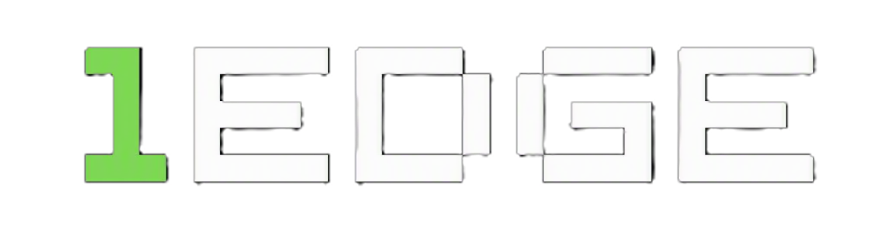

Docs

# Launch and trade coins with <em>people</em>, not bots.

One pass, earned with a quick human check, is your way in. Everything you can do on 1EDGE, what every mark means, and what it costs, in one place.

<a class="ed-btn" href="start/get-your-pass/">Get your pass →</a>
<a class="ed-btn ghost" href="trade/marks/">What the marks mean</a>

<a class="ed-card" href="start/get-your-pass/">Start<b>Get in</b>The pass, your 1EDGE Wallet, backing it up, chains, your @username.</a>
<a class="ed-card" href="launch/modes/">Launch<b>Every mode</b>EDGE, Tek, EDGEstocks, open launches. What each one means for you.</a>
<a class="ed-card" href="trade/buy-and-sell/">Trade<b>Buy, sell, bridge</b>Instant trades, slippage, fees per chain, paying with SOL on Robinhood Chain.</a>
<a class="ed-card" href="trade/alpha-stream/">Trade<b>Alpha Stream</b>What's moving, as it moves.</a>
<a class="ed-card" href="rewards/tiers/">Rewards<b>Rebates, referrals, Seasons</b>Fees back on every trade, 25% of what your people pay, and the monthly Season.</a>
<a class="ed-card" href="help/safety/">Help<b>Stay safe</b>Scams, keys, the port warning, getting support.</a>

