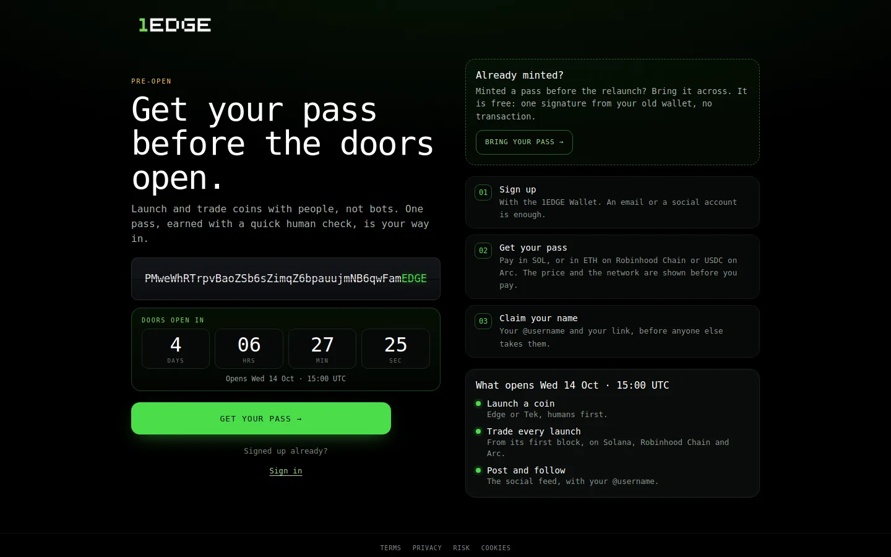

Start

# Getting started

1EDGE is a launchpad, a trading terminal and a social feed in one, on Solana, Robinhood Chain and Arc. Coins launch on a bonding curve that only people with a pass can buy, so the first buyers are humans, not bot farms.

## Your first five minutes

1. **[Get your pass](get-your-pass.md).** Sign up with the 1EDGE Wallet, take a one-minute check, pay once. You're in on all three chains.
2. **[Back up your wallet](wallet.md#back-up-your-wallet).** Save both keys in a password manager.
3. **[Claim your name](profile.md).** Your `@username` and your referral link.
4. **Find a coin** on the board. Learn [the marks](../trade/marks.md) once and you can read any card.
5. **[Make your first trade](../trade/buy-and-sell.md).** Turn on [instant trades](../trade/buy-and-sell.md#instant-trades) to skip the popup.

## Where things are

| Where | What's there |
|---|---|
| **Explore** (home) | The Discover board: every coin, filters, stages. See [Find coins](../trade/discover.md). |
| **A coin's page** | Chart, trades, holders, info, buy/sell, call, PnL. |
| **Launch** | Make a coin. See [Launch a coin](../launch/launching.md). |
| **Social** | The feed, communities, messages. See [EdgeSocial](../social/feed.md). |
| **Dashboard** | Your positions, watchlist, rewards, rebates and referrals, trophy cabinet, token locks, settings. |
| **Your wallet** | Balances, receive, send, bridge, back up. See [Your wallet](wallet.md). |
| **Alpha Stream** | From the top bar. See [Alpha Stream](../trade/alpha-stream.md). |
| **Menu** | Alpha Stream, Activity, Cabinet, Wallet, Support, Callers, Earn and more. |
| **Settings** | Profile, notifications, messages, appearance, display, referrals, wallet, privacy, support. |

## Browse first

You can look around without an account. You need a pass to buy on a curve, launch, post or call. Selling, and trading after graduation, work for anyone.

## Opening day

The doors open **Wednesday 14 October 2026, 15:00 UTC**. Before that, 1edge.app shows the pass journey only: get your pass, claim your name, share your link.

<figure class="ed-shot"><picture><source media="(max-width: 600px)" srcset="../assets/shots/in-390.webp"></picture><figcaption>1edge.app before the doors open: get your pass, bring an old one, claim your name.</figcaption></figure>
